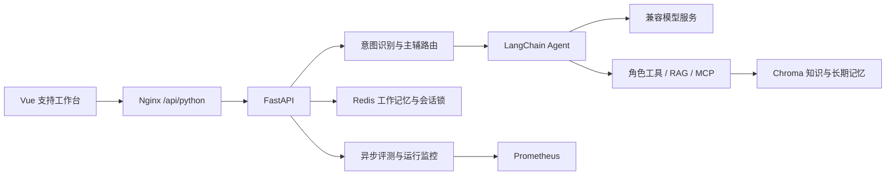

# 架构与目录

## 服务组成

Compose 中后端服务名保留 `echomind`，这是 Nginx 内部解析使用的名称。Redis 与 Chroma 使用容器内部网络；主机页面、API 和监控分别映射到回环地址的 5175、8010、9091 端口。

## 后端模块

| 目录 | 职责 |
| --- | --- |
| `api/` | HTTP 入口、鉴权、会话锁与请求回执 |
| `core/` | 模型适配、意图融合、业务状态、并发、Skills |
| `agents/` | 路由编排、LangChain 循环与角色工具 |
| `tooling/` | 知识库、检索增强、MCP 客户端与服务端 |
| `memory/` | 会话提交、摘要压缩、情景记忆与画像 |
| `evaluation/` | 异步评测任务、Judge、Few-shot 与回归比较 |
| `monitor/` | 运行统计、告警和性能降级 |
| `skills/` | 通用、技术和账单三类业务规范 |
| `config/` | Prometheus 与外部 MCP 配置 |
| `tests/` | 离线回归、协议、并发与工具测试 |

GeneralAgent 负责通用咨询，TechnicalAgent 负责 API、认证与排障，BillingAgent 负责费用与订阅咨询；EscalationAgent 根据上下文生成人工交接摘要。

## 数据存放

| Compose 数据卷 | 内容 |
| --- | --- |
| `redis-data` | 工作记忆、回执及相关状态 |
| `chroma-data` | 知识文档向量、情景记忆与画像 |
| `app-data` | 应用持久化文件与评测相关状态 |
| `prometheus-data` | 监控时序数据 |

`docker compose down` 保留这些卷。变更镜像、修改 Skills 和清理依赖缓存不需要删除数据卷。存储示意可参考 [数据存储图](saas-storage-overview-v2.png)，具体字段和当前实现以代码为准。
