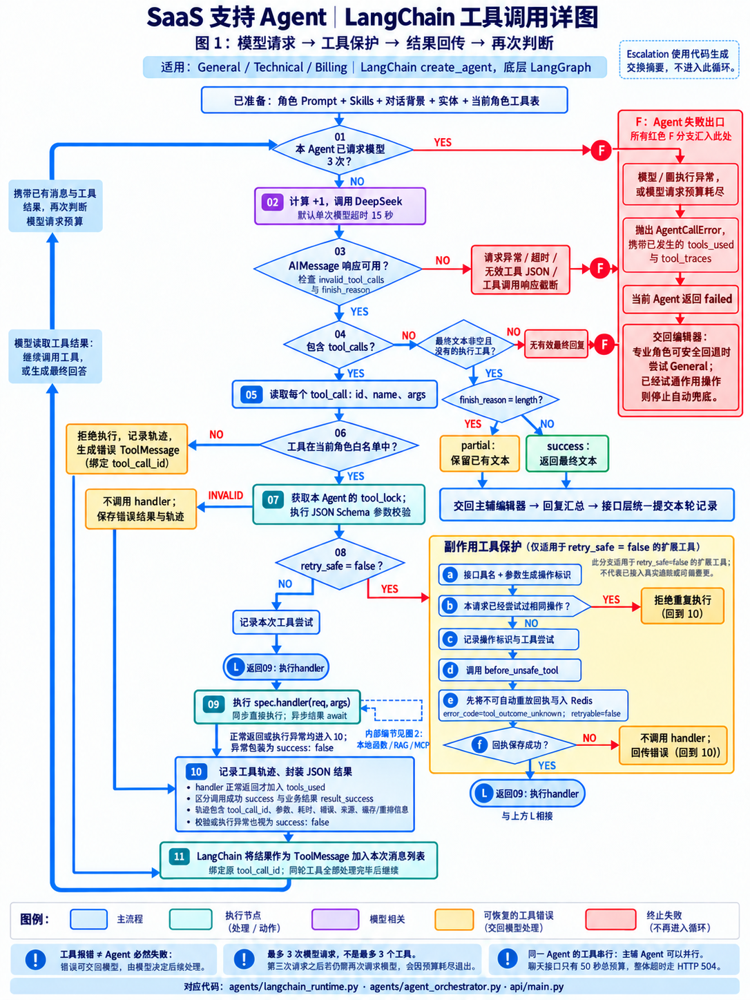
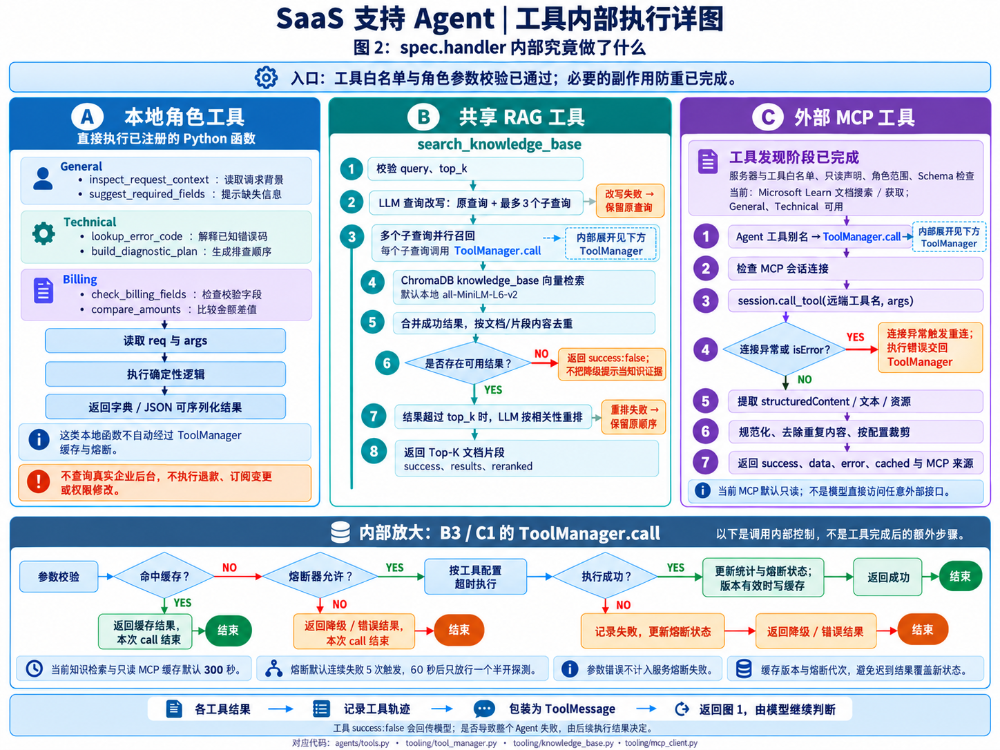

# LangChain 工具调用细节图

以下示意图用于辅助阅读；实际调用预算、分支和权限以当前代码为准。

## 图 1：模型与工具主循环

展开模型请求预算、响应完整性检查、角色工具白名单、JSON Schema 校验、工具串行执行、副作用操作防重、Redis 前置回执、工具轨迹、ToolMessage 回传及 success / partial / failed 出口。

副作用保护中的 L 标记是连接符：回执保存成功后，接到上方 L，再执行节点09。回执失败或重复操作被拒绝时不执行 handler。

图中“最多3次模型请求”指每个普通 Agent 的 LangChain 主循环请求计数。RAG 工具内部的查询改写和重排是额外模型调用，不计入这个主循环计数，但仍受 HTTP 聊天的50秒总预算限制。

普通工具函数的参数校验或执行异常会包装为错误结果回传模型，整个 Agent 可以继续处理。无效模型工具参数、工具调用响应截断、模型请求失败、无有效最终回复和主循环预算耗尽等，会走 AgentCallError / failed 路径。接口总超时另走 HTTP 504。

轨迹中的 success 表示调用过程是否正常完成；result_success 表示工具返回的业务结果。handler 正常返回时才加入 tools_used，即使其业务结果 success 为 false。

## 图 2：工具内部与可靠性控制

分别展开本地角色函数、共享 RAG 工具、外部 MCP 工具；下方 ToolManager 是 RAG 子查询调用与 MCP 调用的内部放大，不是这些工具执行完后再运行的一步。本地角色函数不自动经过该层。

ToolManager 的缓存命中、熔断拒绝分支均直接结束本次内部调用。允许执行时，按配置应用超时，并更新统计、熔断和缓存；失败结果交回外层工具与模型处理。

## 代码位置

- SaaSBackend/agents/langchain_runtime.py：主循环、middleware、参数与副作用保护、轨迹。
- SaaSBackend/agents/tools.py：本地角色工具及共享 RAG 入口。
- SaaSBackend/tooling/tool_manager.py：查询改写、并行召回、去重、重排、缓存及熔断。
- SaaSBackend/tooling/mcp_client.py：外部工具发现、注册、调用、结果规范化及裁剪。
- SaaSBackend/agents/agent_orchestrator.py：状态处理与 General 失败兜底。
- SaaSBackend/api/main.py：副作用工具前置回执及本轮统一提交。
